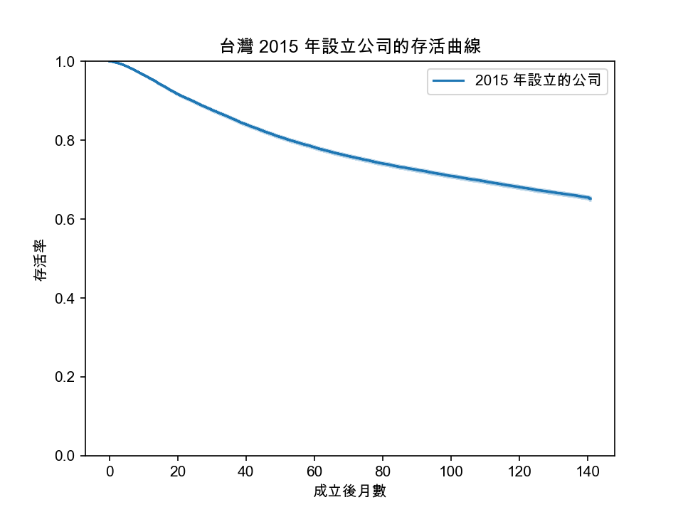
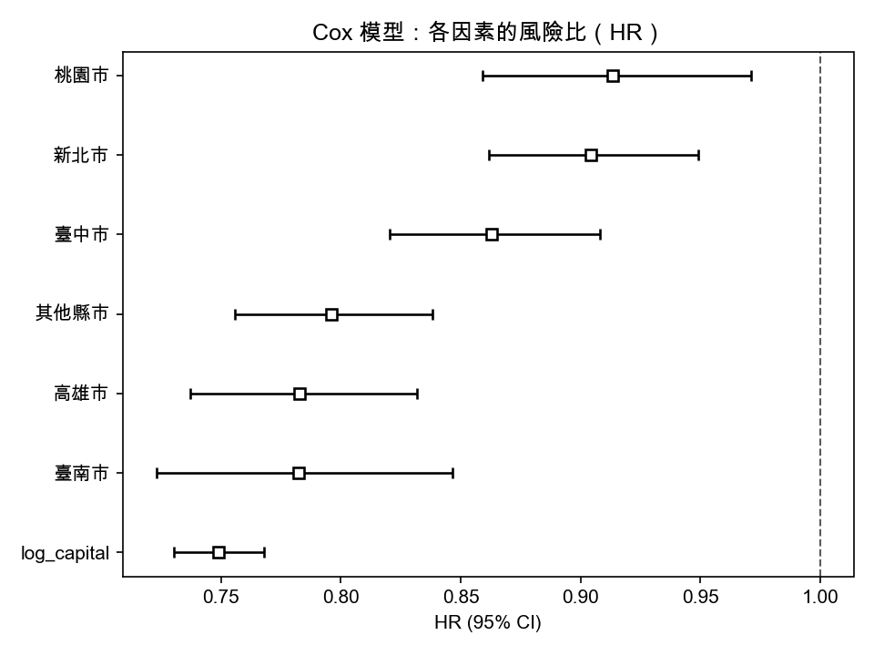

# 台灣公司存活分析：2015 年設立的公司能撐多久？

以政府公開的公司登記資料，追蹤 **2015 年在台灣設立的 43,934 家公司**至 2026 年 9 月，使用 Kaplan-Meier 存活曲線與 Cox 比例風險模型，分析資本額與縣市對公司歇業風險的影響。



---

## 主要發現

### 1. 約三分之一的公司在 11 年內解散

| 成立後 | 存活率 |
|---|---|
| 1 年 | 95.6% |
| 3 年 | 85.5% |
| 5 年 | 78.3% |
| 10 年 | 68.2% |

追蹤期間共有 14,859 家（33.8%）解散。存活曲線在前 3 年下降最快，之後趨緩，符合創業研究中「新創劣勢（liability of newness）」的現象。

### 2. 資本額越大，存活率越高


| 資本額 | 公司數 | 5 年存活率 |
|---|---|---|
| 50 萬以下 | 14,843 | 73.9% |
| 50 萬～100 萬 | 11,946 | 78.3% |
| 100 萬～500 萬 | 11,741 | 81.0% |
| 500 萬以上 | 5,102 | 83.3% |

四組呈現一致的遞增關係（log-rank test, p < 0.001）。

### 3. 控制資本額後，臺北市的歇業風險仍最高



Cox 模型（以臺北市為對照組）：

| 變數 | HR | 95% 信賴區間 |
|---|---|---|
| 資本額（每增加 10 倍） | 0.749 | 0.730–0.768 |
| 臺南市 | 0.782 | 0.723–0.846 |
| 高雄市 | 0.783 | 0.737–0.832 |
| 其他縣市 | 0.796 | 0.756–0.838 |
| 臺中市 | 0.863 | 0.820–0.908 |
| 新北市 | 0.904 | 0.862–0.949 |
| 桃園市 | 0.913 | 0.859–0.971 |

- 資本額每增加 10 倍，歇業風險降低約 25%
- 所有縣市的風險都低於臺北市，大致呈現「北高南低」
- C-index = 0.561，顯示資本額與縣市只能解釋公司存活的一小部分

### 4. 資本的保護作用在創業第一年最強

比例風險假設檢定顯示資本額的效果隨時間變化（Schoenfeld residuals test）。將追蹤期間分為兩段分別估計：

| 時期 | 資本額 HR | 風險降低 |
|---|---|---|
| 成立第一年 | 0.634 | 37% |
| 第一年後 | 0.768 | 23% |

資本在公司尚未建立穩定收入的初期扮演最重要的緩衝角色。分段後，資本額的假設檢定統計量由 28.5 降至 9.1。

---

## 資料

| 資料集 | 用途 |
|---|---|
| [公司設立登記清冊（月份）](https://data.gov.tw/dataset/6047) | 定義研究世代：設立日期、資本額、所在地 |
| [公司解散登記清冊（月份）](https://data.gov.tw/dataset/6049) | 事件：解散日期 |

- 期間：2013 年 2 月至 2026 年 9 月，各 164 個月份檔案
- 研究世代：核准設立日期在 2015 年的公司
- 資料截止日：2026-09-30，截止時仍存續的公司視為右設限

**資料處理規則**

- 民國日期轉換為西元
- 同一統編重複出現時，保留日期最早的紀錄（設立 7 筆、解散 52 筆）
- 資本額為 0 的公司（多為外國公司分公司）不納入資本額相關分析
- 縣市取公司所在地前 3 字；Cox 模型中保留前 6 大縣市，其餘合併為「其他縣市」

**資料授權**

本專案使用之資料由經濟部商業發展署提供（公司設立登記清冊（月份）、公司解散登記清冊（月份）），依[政府資料開放授權條款－第 1 版](https://data.gov.tw/license)釋出。

---

## 方法

1. **Kaplan-Meier 估計**：描述整體與分組存活曲線
2. **Log-rank test**：檢定組間存活曲線差異
3. **Cox 比例風險模型**：控制其他變數後估計資本額（取 log10）與縣市的風險比
4. **比例風險假設檢定**：Schoenfeld residuals 檢定與 log-log 圖
5. **分段 Cox 模型**：以第 12 個月為切點，分別估計第一年與第一年後的效果

---

## 研究限制

- **歇業可能被低估**：解散清冊可能未包含經主管機關撤銷或廢止登記的公司，實際歇業比例可能高於本研究估計，且此偏誤可能因地區而異（例如各地辦理正式解散的習慣不同）
- **未納入產業別**：營業項目需透過 API 逐筆查詢，本研究未納入。產業可能是影響存活的重要因素，也可能解釋部分縣市差異
- **大樣本下的顯著性**：樣本超過 4 萬家，微小差異亦會達統計顯著，解讀時應同時考量效果大小

## 未來方向

- 透過商工登記 API 補充產業別與公司現況，驗證撤銷、廢止的影響
- 比較疫情前（2019）與疫情期間（2020）設立公司的存活差異
- 嘗試 AFT 模型或 Random Survival Forest，比較預測能力

---

## 專案結構

```
Taiwan-company-survival/
├── data/
│   ├── raw/            # 原始清冊（不上傳）
│   └── processed/      # 合併與整理後的資料（不上傳）
├── notebooks/          # 探索與分析
├── src/                # 資料下載與整理程式
├── reports/figures/    # 圖表
└── environment.yml     # 環境設定
```

## 重現方式

**1. 建立環境**

```bash
conda env create -f environment.yml
conda activate forecasting
```

**2. 下載並整理資料**（在 `src/` 資料夾內執行）

```bash
cd src
python get_file_list.py          # 取得各月份檔案的下載網址
python download_files.py         # 下載所有月份清冊（約 10 分鐘）
python combine_files.py          # 合併成兩個大表
python build_survival_table.py   # 建立 2015 年世代存活分析表
```

**3. 分析**

依編號執行 `notebooks/` 內的檔案。

## 使用工具

Python · pandas · lifelines · matplotlib
